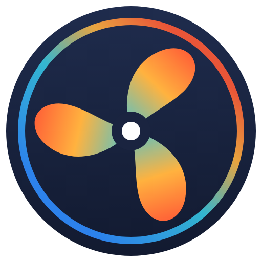

# ioBroker.dreo-control

**Tests:** 

## dreo-control adapter for ioBroker

Control [Dreo](https://www.dreo.com) smart heaters and fans via the Dreo cloud.

The adapter logs in to your Dreo account, discovers all registered devices and creates states to monitor and control them. Changes made on the device or in the Dreo app are received in real time via WebSocket; a configurable polling interval serves as fallback.

### Disclaimer

**All product and company names or logos are trademarks™ or registered® trademarks of their respective holders. Use of them does not imply any affiliation with or endorsement by them or any associated subsidiaries! This personal project is maintained in spare time and has no business goal.**

### Supported devices

| Type | Models | Notes |
|------|--------|-------|
| Heaters | Atom 316, DR-HSH series | |
| Fans | DR-HTF, DR-HCF, DR-HPF series | |
| Other | all further Dreo devices | only power and info states |

Device support is provided by the [dreo-client](https://github.com/marc2016/dreo-client) library. If your device is only detected as "other", please open an issue with the model name shown in the log.

### Requirements

- Node.js >= 22
- js-controller >= 6.0.11, admin >= 7.0.23

### Configuration

| Setting | Description |
|---------|-------------|
| E-mail | E-mail address of your Dreo account |
| Password | Password of your Dreo account (stored encrypted) |
| Region | `Europe` or `North America / Global`, depending on where your account is registered. Temperatures are shown in °C for Europe and °F for North America. |
| Refresh interval | Polling interval in seconds as fallback to real-time updates (minimum 60, default 300) |
| Use real-time updates | Receive device changes instantly via WebSocket |

If the login fails, the adapter logs an error and retries with an increasing delay (5 minutes up to 1 hour) instead of restarting.

### States

| State | Description |
|-------|-------------|
| `info.connection` | Connection to the Dreo cloud |
| `commands.manualRefresh` | Button to refresh all devices immediately |

For every device, a device object named by its serial number is created (`dreo-control.0.<serialNumber>`):

| State | Devices | Writable | Description |
|-------|---------|:--------:|-------------|
| `power` | all | ✓ | Power on/off |
| `info.online` | all | | Device connected to the Dreo cloud (updated with every refresh) |
| `info.model` | all | | Device model |
| `info.name` | all | | Device name from the Dreo app |
| `info.product` | all | | Product name, e.g. `Dreo 316S` |
| `temperature` | heater | | Current temperature |
| `targetTemperature` | heater | ✓ | Target temperature |
| `mode` | heater | ✓ | Operating mode: `heat`, `eco`, `fan` |
| `heatLevel` | heater | ✓ | Heat level 1–3 (switches to `heat` mode) |
| `oscillation` | heater, fan | ✓ | Horizontal oscillation |
| `childLock` | heater | ✓ | Child lock |
| `timer` | heater | ✓ | Shutdown timer in hours (0–12) |
| `tippedOver` | heater | | Tip-over safety switch triggered |
| `speed` | fan | ✓ | Speed level 1–12 |
| `verticalOscillation` | fan | ✓ | Vertical oscillation |
| `windType` | fan | ✓ | Wind mode: `normal`, `natural`, `sleep`, `auto` |

## Changelog
<!--
    Placeholder for the next version (at the beginning of the line):
    ### **WORK IN PROGRESS**
-->
### 0.1.1 (2026-10-24)
* (Marc Lammers) Node.js 22 or newer is required

### 0.1.0 (2026-10-24)
* (Marc Lammers) initial release
* (Marc Lammers) Dreo cloud integration for heaters and fans with real-time updates
* (Marc Lammers) Added `info.product`, `info.online` now reflects the real connection state

## License
MIT License

Copyright (c) 2026 Marc Lammers <marc@lammers.dev>

Permission is hereby granted, free of charge, to any person obtaining a copy
of this software and associated documentation files (the "Software"), to deal
in the Software without restriction, including without limitation the rights
to use, copy, modify, merge, publish, distribute, sublicense, and/or sell
copies of the Software, and to permit persons to whom the Software is
furnished to do so, subject to the following conditions:

The above copyright notice and this permission notice shall be included in all
copies or substantial portions of the Software.

THE SOFTWARE IS PROVIDED "AS IS", WITHOUT WARRANTY OF ANY KIND, EXPRESS OR
IMPLIED, INCLUDING BUT NOT LIMITED TO THE WARRANTIES OF MERCHANTABILITY,
FITNESS FOR A PARTICULAR PURPOSE AND NONINFRINGEMENT. IN NO EVENT SHALL THE
AUTHORS OR COPYRIGHT HOLDERS BE LIABLE FOR ANY CLAIM, DAMAGES OR OTHER
LIABILITY, WHETHER IN AN ACTION OF CONTRACT, TORT OR OTHERWISE, ARISING FROM,
OUT OF OR IN CONNECTION WITH THE SOFTWARE OR THE USE OR OTHER DEALINGS IN THE
SOFTWARE.